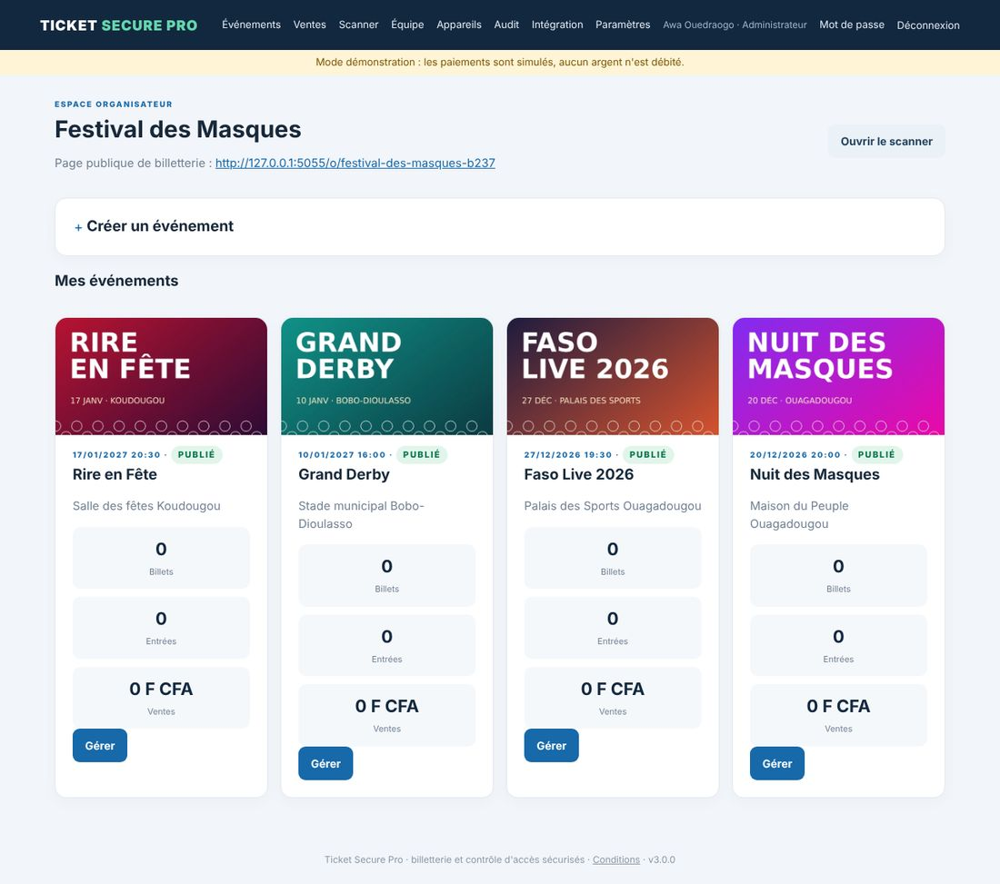
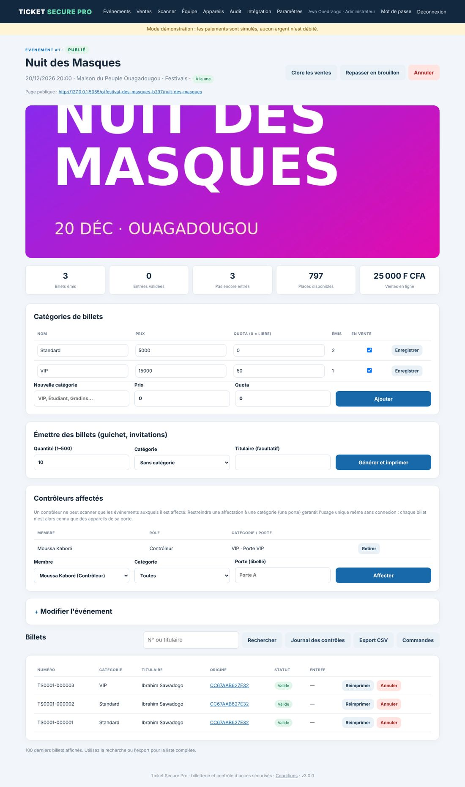
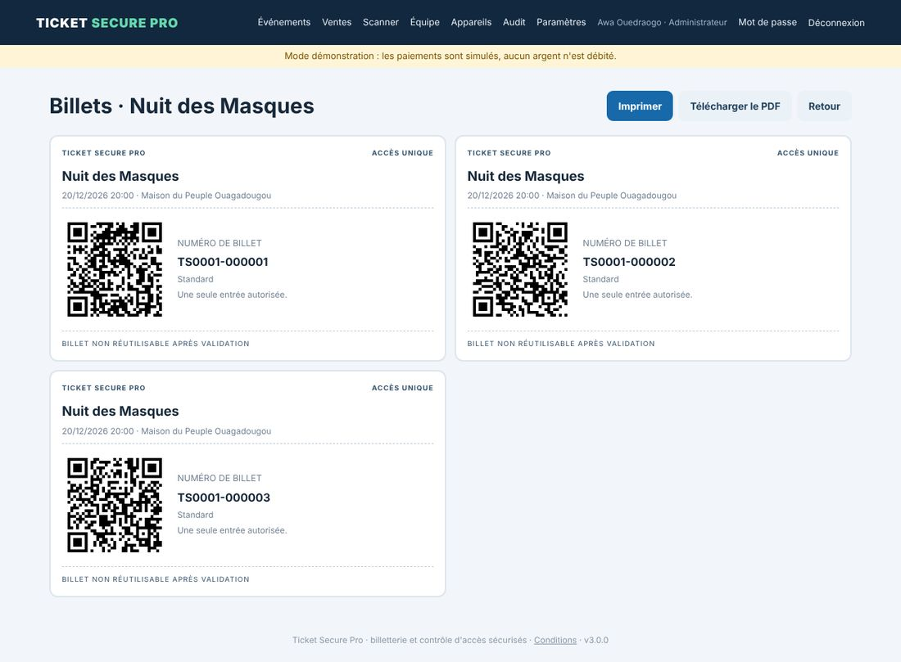
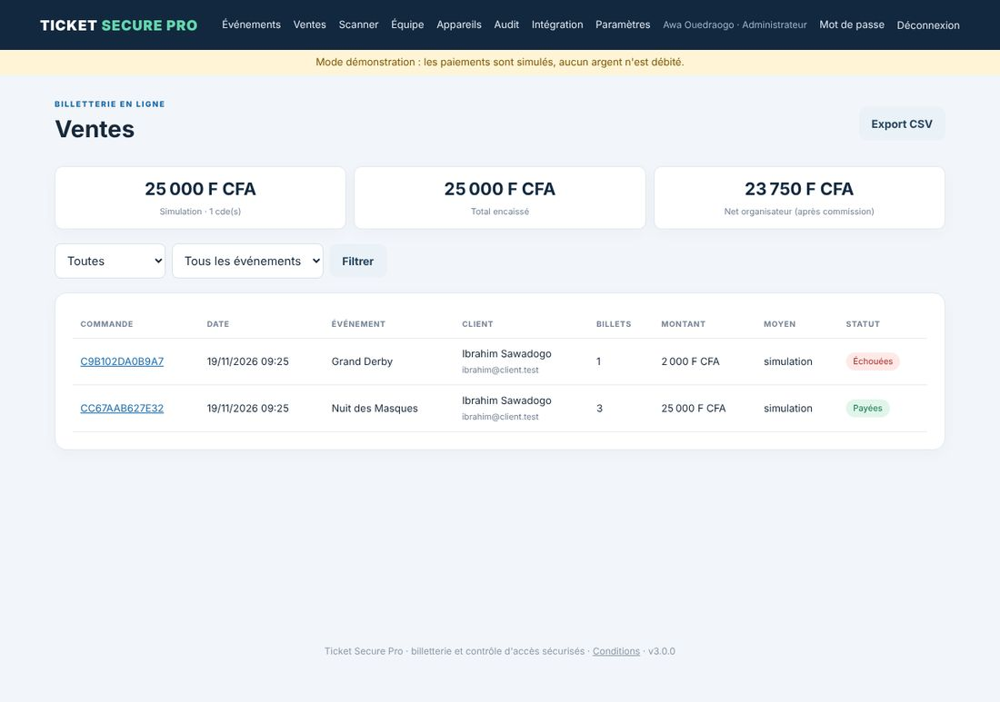
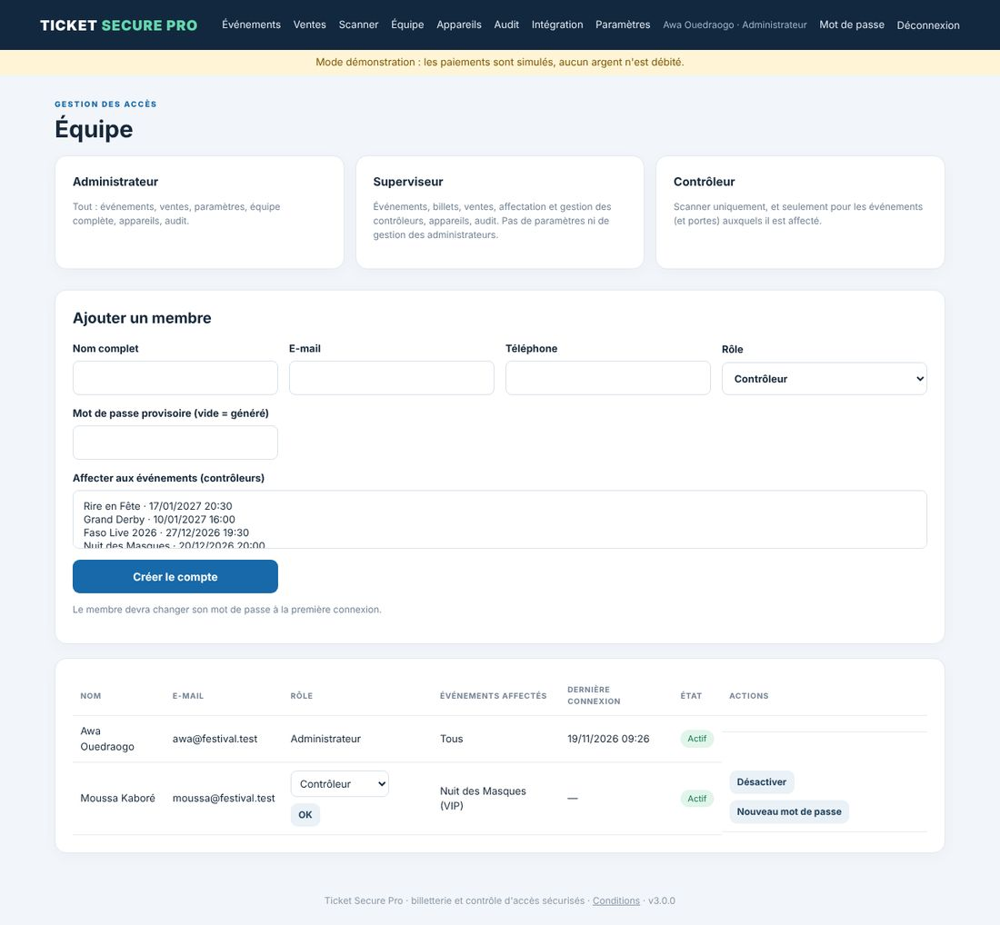
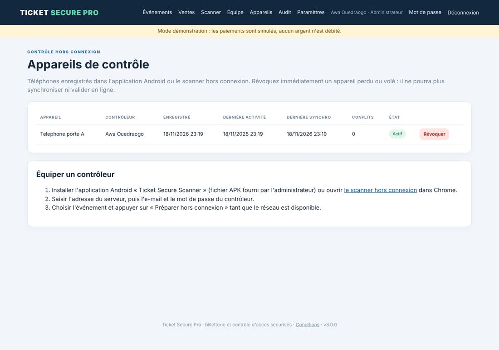
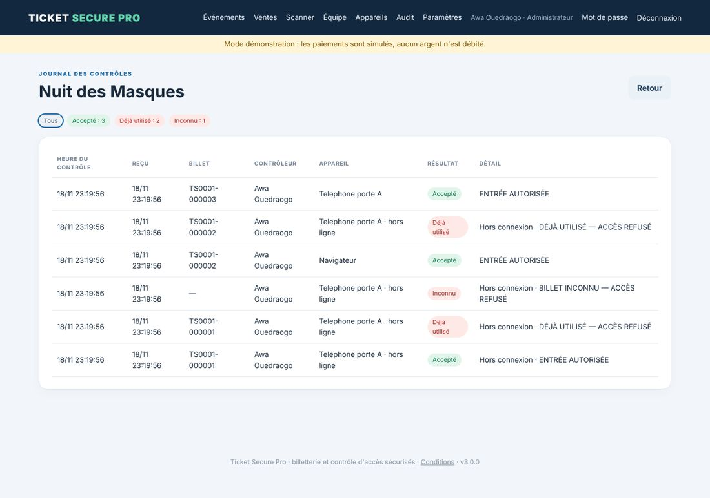

# Guide de l'organisateur

Ce guide accompagne une société organisatrice, de la création de son espace jusqu'au soir de l'événement.

## 1. Créer votre espace

1. Sur la plateforme, cliquez sur **Espace organisateur**, puis **Créer votre espace**.
2. Indiquez le nom de votre société, votre nom, votre e-mail professionnel et un mot de passe d'au moins 12 caractères.
3. Vous êtes **Administrateur** de votre espace. Vos événements, ventes, équipe et journaux sont séparés de ceux des autres organisateurs.

## 2. Créer un événement

Menu **Événements** → **Créer un événement** :

- nom, date et heure (heure locale), lieu, ville ;
- **capacité** (0 = illimitée) et prix du billet standard ;
- **genre** (concert, festival, sport…) : il sert aux filtres de la billetterie ;
- **affiche** : image JPEG, PNG ou WebP (8 Mo au plus). Elle est redimensionnée et nettoyée automatiquement (les métadonnées de l'appareil photo, comme la position GPS, sont supprimées). Format conseillé : paysage 4/3 ou 16/9 ;
- **vente en ligne** et **contrôle hors connexion** (voir le guide du contrôleur) ;
- description.

L'événement est créé en **brouillon** : il n'est visible par personne tant qu'il n'est pas publié.

## 3. Catégories de billets et publication

Sur la fiche de l'événement :

1. **Catégories de billets** : modifiez la catégorie « Standard », ajoutez-en d'autres (VIP, Étudiant, Gradins…) avec un prix et, si besoin, un **quota** (nombre maximal de billets de cette catégorie).
2. Cliquez sur **Publier** : l'événement apparaît sur la billetterie de la plateforme, sur votre page publique et dans le widget de votre site.
3. **Clore les ventes** arrête la vente en ligne sans annuler l'événement ; **Annuler** fait refuser tous les billets au contrôle.

## 4. Vendre

- **En ligne** : sur la billetterie de la plateforme (place de marché), sur votre page publique `/o/votre-organisation`, ou **sur votre propre site** grâce au widget (voir le guide d'intégration). Les clients paient par Wave, Orange Money ou carte ; les billets sont émis dès la confirmation de l'opérateur et envoyés par e-mail.
- **Au guichet ou en invitations** : section « Émettre des billets » de la fiche événement. Choisissez la quantité et la catégorie, puis imprimez ou téléchargez le PDF.

Le menu **Ventes** affiche chaque commande, le total par moyen de paiement, la commission de la plateforme et le **net qui vous revient**. Export CSV disponible.

Depuis une commande, vous pouvez **renvoyer les billets** (à une autre adresse si le client s'est trompé) ou **vérifier le paiement auprès de l'opérateur** si une confirmation tarde.

## 5. Votre équipe et les accès

Menu **Équipe** :

| Rôle | Peut faire |
|---|---|
| **Administrateur** | Tout, y compris les paramètres, l'intégration et la gestion des autres administrateurs |
| **Superviseur** | Événements, billets, ventes, gestion et affectation des contrôleurs, appareils, audit |
| **Contrôleur** | Scanner les billets, uniquement pour les événements (et portes) auxquels il est affecté |

À la création d'un compte, un mot de passe provisoire est affiché : transmettez-le de façon sûre ; le membre devra le changer à sa première connexion. Vous pouvez désactiver un compte (ses téléphones sont alors révoqués) ou générer un nouveau mot de passe provisoire.

**Affecter les contrôleurs** : sur la fiche de l'événement, section « Contrôleurs affectés », choisissez le membre, éventuellement une **catégorie** (une porte : VIP, Standard…) et un libellé de porte. Un contrôleur affecté à la porte VIP ne pourra valider que des billets VIP.

## 6. Le jour J

- **Appareils** : liste des téléphones de contrôle, leur dernière synchronisation et les éventuels conflits. **Révoquez immédiatement un téléphone perdu.**

- **Journal des contrôles** (fiche événement) : chaque passage, accepté ou refusé, avec l'heure, le contrôleur et l'appareil ; filtre par résultat.

## 7. Intégration à votre site et paramètres

- **Intégration** : autorisez votre site et copiez le code du widget (guide dédié).
- **Paramètres** : nom public, e-mail et téléphone de contact affichés aux clients.
- **Audit** : historique de toutes les actions sensibles de votre organisation, exportable.

## Bonnes pratiques

- Publiez l'événement **après** avoir vérifié les catégories, les prix et la capacité.
- Équipez et préparez les téléphones de contrôle **la veille**, avec du réseau (voir le guide du contrôleur).
- Pour les grands événements à plusieurs entrées, affectez chaque contrôleur à **une porte (catégorie)** : c'est ce qui garantit l'usage unique même sans réseau.
- Ne partagez jamais un compte entre plusieurs personnes : chaque action est tracée au nom de son auteur.
