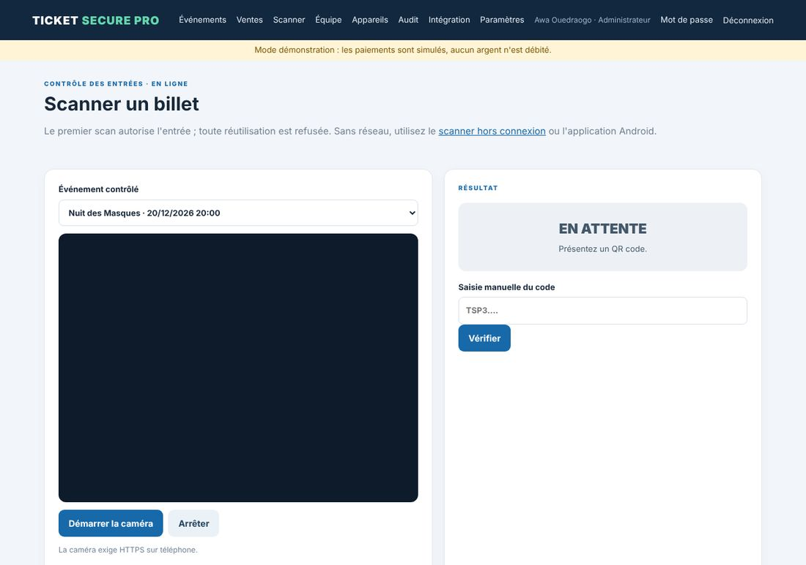
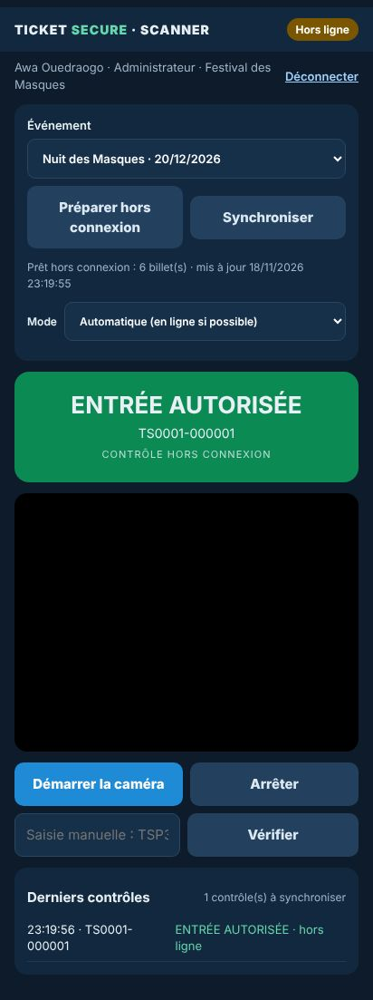
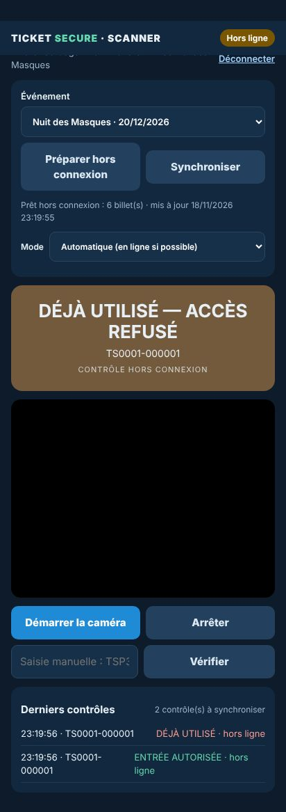

# Guide du contrôleur

Ce guide s'adresse aux personnes qui contrôlent les billets à l'entrée.

## L'outil de contrôle

Deux possibilités, au choix de l'organisateur :

- **L'application Android « Ticket Secure Scanner »** (fichier APK fourni par l'organisateur). Elle fonctionne entièrement sans réseau une fois préparée.
- **Le scanner web**, ouvert dans Chrome sur le téléphone (adresse : `https://VOTRE-PLATEFORME/static/scanner/index.html`). Il peut être ajouté à l'écran d'accueil et fonctionne lui aussi hors connexion.

Un troisième écran, **Scanner** dans l'espace web (ordinateur ou téléphone connecté), valide en ligne uniquement.

## Avant l'événement (avec du réseau)

1. Connectez-vous **une fois** sur le site web avec votre compte, et changez votre mot de passe provisoire.
2. Ouvrez l'application (ou le scanner web) et saisissez : l'adresse de la plateforme (`https://…`), votre e-mail, votre mot de passe et un nom pour le téléphone (par exemple « Porte VIP 1 »).
3. Choisissez l'événement dans la liste. Seuls les événements auxquels vous êtes affecté apparaissent.
4. Appuyez sur **Préparer hors connexion** : le téléphone télécharge la liste des billets (sans les noms des clients). Le message « Prêt hors connexion : N billet(s) » confirme.

Faites cette préparation **la veille ou juste avant l'ouverture des portes**, et recommencez si de nombreuses ventes ont eu lieu entre-temps.

## Pendant l'événement

1. Appuyez sur **Démarrer la caméra** et présentez le QR code du billet (sur téléphone ou imprimé). Le résultat s'affiche en grand, avec un son et une vibration :

| Message | Couleur | Que faire |
|---|---|---|
| **ENTRÉE AUTORISÉE** | Vert | Laisser entrer. Le billet est désormais utilisé. |
| **DÉJÀ UTILISÉ — ACCÈS REFUSÉ** | Rouge | Refuser : ce billet a déjà servi (copie ou capture d'écran). |
| **BILLET INCONNU — ACCÈS REFUSÉ** | Rouge | Refuser : faux billet, autre événement, ou billet d'une autre porte. |
| **BILLET ANNULÉ** | Rouge | Refuser : billet annulé par l'organisateur. |
| **MAUVAIS ÉVÉNEMENT OU MAUVAISE PORTE** | Orange | Orienter la personne vers la bonne entrée. |

2. Si la caméra ne lit pas le QR : demandez au client d'augmenter la luminosité de son écran ou de présenter le billet PDF, et essuyez l'objectif. Le numéro imprimé sous le QR (TS0001-000123) **ne suffit pas** pour entrer : il se devine facilement, seul le QR fait foi. La « saisie manuelle » accepte le code complet contenu dans le QR (il commence par `TSP3.`) et sert surtout aux essais.

| Accepté (hors connexion) | Refusé (déjà utilisé) |
|---|---|
|  |  |

## Avec ou sans réseau

- **Avec réseau**, chaque billet est vérifié par le serveur : un billet ne peut entrer qu'une fois, même si plusieurs contrôleurs le scannent au même instant.
- **Sans réseau**, le téléphone décide seul à partir de la liste préparée. La pastille en haut indique « Hors ligne », et la mention « CONTRÔLE HORS CONNEXION » apparaît sous chaque résultat. Les contrôles sont mis en file d'attente.
- **Dès que le réseau revient**, la file est envoyée automatiquement (toutes les 20 secondes) et le téléphone apprend quels billets ont été utilisés aux autres entrées. Le bouton **Synchroniser** force l'envoi.

**Conflit** : si deux entrées sans réseau ont accepté le même billet, la synchronisation le signale (« CONFLIT ») au téléphone et au superviseur. C'est pour l'éviter que l'organisateur peut affecter chaque contrôleur à une seule porte.

## Fin de service et incidents

- Ne vous déconnectez pas tant que « Tout est synchronisé » n'est pas affiché : des contrôles non envoyés seraient perdus.
- **Téléphone perdu ou volé** : prévenez immédiatement le superviseur, qui le révoque depuis le menu **Appareils** ; le téléphone ne peut alors plus rien valider ni envoyer.
- **Message « Appareil révoqué »** : reconnectez-vous ou demandez au superviseur.
