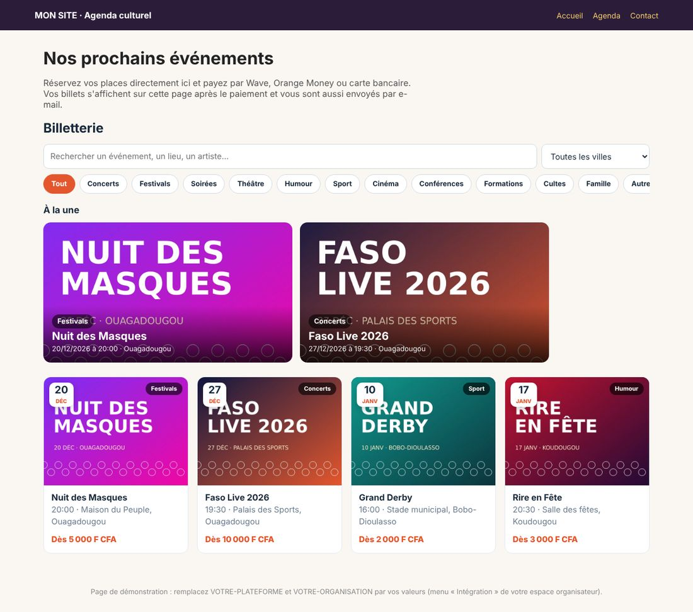
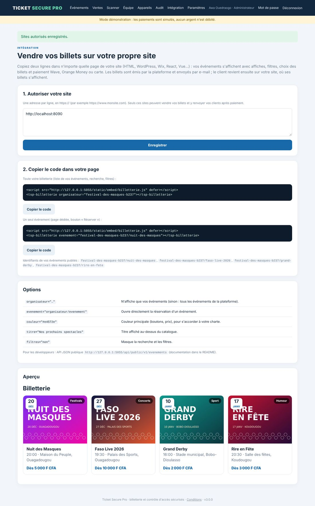
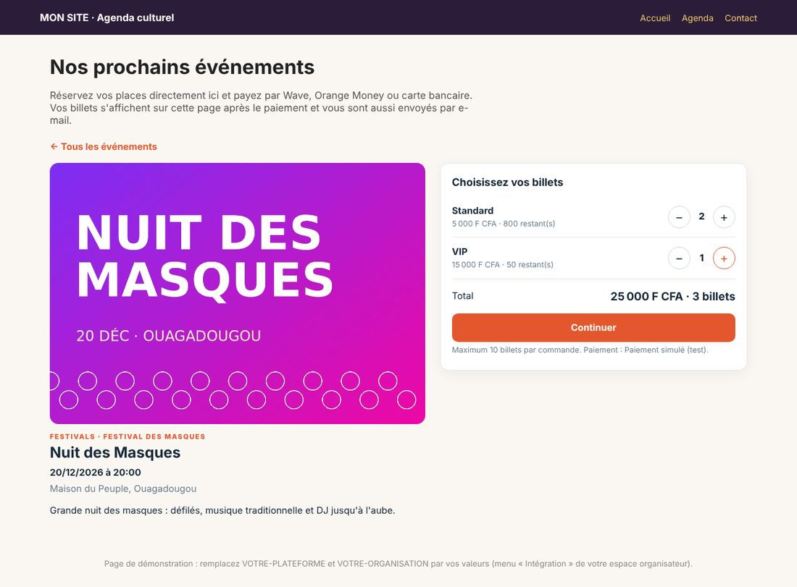
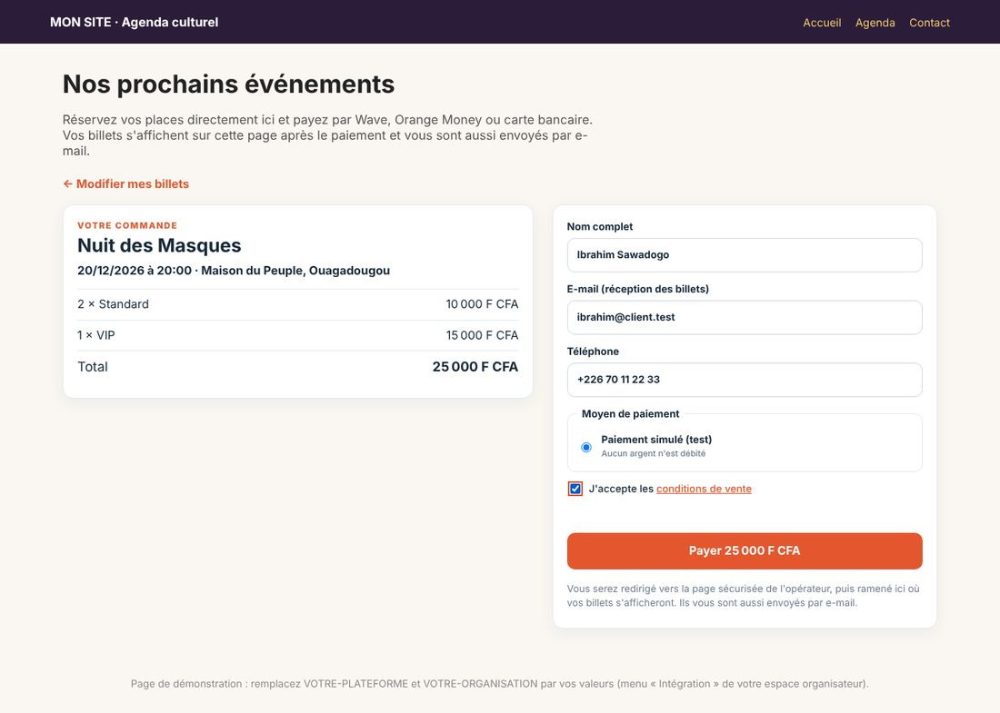
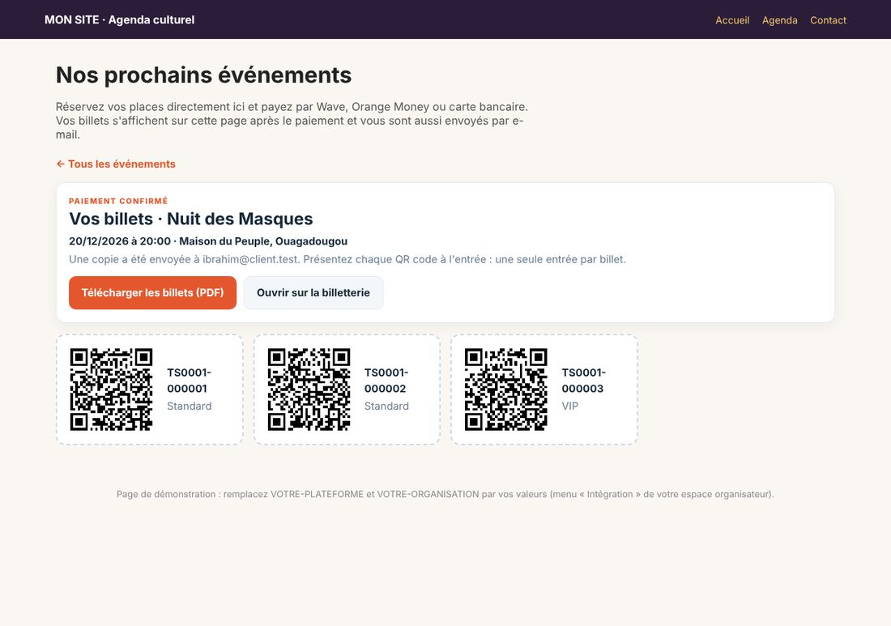
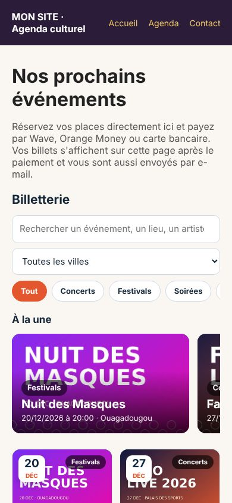
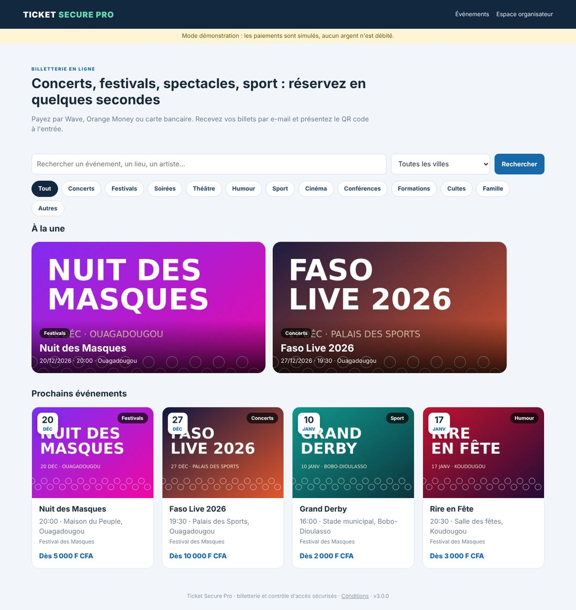

# Intégrer la billetterie à votre site ou application web

Ce guide explique comment afficher vos événements et vendre vos billets **directement sur votre propre site**, comme sur une billetterie en ligne : catalogue avec affiches, recherche, filtres par genre et par ville, événements « à la une », choix des billets, paiement Wave, Orange Money ou carte bancaire, puis affichage des billets avec leur QR code.

Trois façons d'intégrer, de la plus simple à la plus libre :

| Option | Pour qui | Ce que voit le client |
|---|---|---|
| **A. Widget** (recommandé) | Tout site où l'on peut ajouter du code HTML : site fait main, WordPress installé chez un hébergeur, React, Vue, Angular… | La billetterie complète **dans votre page**, aux couleurs de votre site |
| **B. Lien ou bouton** | Sites qui n'acceptent pas de script (WordPress.com gratuit, certains constructeurs de sites, réseaux sociaux) | Un bouton « Réserver » qui ouvre la billetterie de la plateforme |
| **C. API** | Développeurs qui veulent une interface entièrement personnalisée | Ce que vous construisez |



## Option A — le widget, en deux lignes

### Étape 1 : autoriser votre site

Pour des raisons de sécurité, seuls les sites que vous déclarez peuvent vendre vos billets et y ramener vos clients après le paiement.

1. Connectez-vous à votre espace organisateur avec un compte **Administrateur**.
2. Menu **Intégration**.
3. Dans « Autoriser votre site », saisissez l'adresse de votre site, **une par ligne**, en `https://` :
   ```
   https://www.monsite.com
   https://monsite.com
   ```
   Indiquez seulement le domaine (le chemin, comme `/agenda`, est ignoré). Déclarez séparément `www.monsite.com` et `monsite.com` si les deux sont utilisés.
4. Cliquez sur **Enregistrer**.



### Étape 2 : copier le code dans votre page

La page **Intégration** vous donne le code exact à copier. Il ressemble à ceci :

```html
<script src="https://billets.exemple.com/static/embed/billetterie.js" defer></script>
<tsp-billetterie organisateur="mon-organisation-1a2b"></tsp-billetterie>
```

Collez ces deux lignes à l'endroit de la page où la billetterie doit apparaître. C'est tout : vos événements publiés s'affichent automatiquement, et tout nouvel événement que vous publiez apparaît sans rien changer sur votre site.

Pour une page consacrée à **un seul événement** :

```html
<script src="https://billets.exemple.com/static/embed/billetterie.js" defer></script>
<tsp-billetterie evenement="mon-organisation-1a2b/nuit-des-masques"></tsp-billetterie>
```

L'identifiant `organisation/evenement` de chaque événement publié est affiché sur la page Intégration.

### Options du widget

| Attribut | Effet | Exemple |
|---|---|---|
| `organisateur` | N'affiche que vos événements. Sans cet attribut : tous les événements de la plateforme. | `organisateur="mon-organisation-1a2b"` |
| `evenement` | Ouvre directement la réservation d'un événement. | `evenement="mon-organisation-1a2b/gala"` |
| `couleur` | Couleur principale (boutons, prix, filtres), pour respecter votre charte. | `couleur="#e4572e"` |
| `titre` | Titre affiché au-dessus du catalogue. | `titre="Nos prochains spectacles"` |
| `filtres` | `non` masque la recherche et les filtres (utile pour un petit encadré). | `filtres="non"` |
| `serveur` | Adresse de la plateforme, si le script est chargé autrement (application React, par exemple). | `serveur="https://billets.exemple.com"` |

### Ce que vit le client

1. Il parcourt le catalogue : recherche, ville, genres (concerts, festivals, sport…), événements à la une.
2. Il ouvre un événement, choisit le nombre de billets par catégorie (Standard, VIP…) ; le total s'affiche.
3. Il indique son nom, son e-mail et son téléphone, choisit Wave, Orange Money ou carte, accepte les conditions.
4. Il est redirigé vers la page sécurisée de l'opérateur de paiement.
5. Une fois le paiement confirmé, **il revient sur votre page**, où ses billets s'affichent avec leurs QR codes et un bouton de téléchargement PDF. Il les reçoit aussi par e-mail.
6. Le bouton « Mes billets » permet de les retrouver plus tard sur le même appareil.

Choix des billets sur la fiche de l'événement :



Coordonnées du client et moyen de paiement :



De retour sur votre site après le paiement, les billets s'affichent avec leurs QR codes :



Si le client annule le paiement, il revient aussi sur votre page, qui lui indique qu'aucun billet n'a été émis et lui propose de recommencer.

Le widget s'adapte aux téléphones :



### Exemples selon votre outil

**Site HTML.** Voir le fichier complet `exemples/site-partenaire.html`.

**WordPress (installé chez un hébergeur).** Dans l'éditeur de page, ajoutez un bloc **HTML personnalisé** et collez les deux lignes. Si votre thème ou une extension de sécurité retire les balises `<script>`, utilisez une extension d'insertion de code (par exemple « WPCode ») pour ajouter la ligne `<script …>` dans le pied de page, et gardez la ligne `<tsp-billetterie …>` dans le bloc HTML.

**WordPress.com (offre sans extensions), Wix, Facebook…** Ces outils n'acceptent pas les scripts externes ou les exécutent dans un cadre isolé : utilisez l'option B (bouton).

**React.** Voir `exemples/react/BilletterieTicketSecure.jsx` :

```jsx
<BilletterieTicketSecure organisateur="mon-organisation-1a2b" couleur="#e4572e" />
```

**Vue.** Voir `exemples/vue/Billetterie.vue`. Déclarez l'élément comme composant web :

```js
app.config.compilerOptions.isCustomElement = (tag) => tag.startsWith("tsp-");
```

**Angular.** Ajoutez `CUSTOM_ELEMENTS_SCHEMA` au composant qui contient `<tsp-billetterie>`, et la ligne `<script …>` dans `index.html`.

**Application « une page » (routes avec #).** L'adresse complète de la page, ancre comprise, est conservée : le client revient sur la même vue après paiement.

### Si votre site a une politique de sécurité (CSP)

Si votre site envoie un en-tête `Content-Security-Policy`, ajoutez l'adresse de la plateforme aux directives suivantes :

```
script-src  https://billets.exemple.com;
style-src   https://billets.exemple.com;
img-src     https://billets.exemple.com;
connect-src https://billets.exemple.com;
```

### Sécurité de l'intégration

- Le widget fonctionne dans un **Shadow DOM** : ses styles n'abîment pas votre site, et inversement.
- Il n'utilise **aucun cookie** et n'insère jamais de données sous forme de HTML (pas d'injection de code possible par le nom d'un événement).
- Les commandes ne sont acceptées que depuis les sites autorisés, et le client n'est renvoyé, après paiement, que vers une page de ces sites.
- Le paiement se fait toujours sur la page de l'opérateur (Wave, Orange Money, carte). Votre site ne voit jamais de numéro de carte ni de code secret.
- Une commande n'est payée qu'après confirmation **par l'opérateur** (notification signée ou vérification directe), jamais sur la seule parole du navigateur.
- Les billets affichés sur votre page sont protégés par une clé secrète propre à chaque commande, conservée uniquement dans le navigateur du client.

### En cas de problème

| Symptôme | Cause probable | Solution |
|---|---|---|
| Rien ne s'affiche | Script bloqué ou mal collé | Vérifiez l'adresse du script ; regardez la console du navigateur (touche F12). |
| « Ce site n'est pas autorisé à vendre les billets… » | Domaine non déclaré | Ajoutez l'adresse exacte (avec ou sans `www`) dans Intégration. |
| Le client ne revient pas sur votre site | Page de retour hors des sites autorisés | Déclarez le domaine de la page qui contient le widget. |
| « Aucun événement en vente » | Événements non publiés ou passés | Publiez l'événement dans votre espace (bouton **Publier**). |
| Pas de moyen de paiement proposé | Clés de paiement non configurées sur la plateforme | Voir le guide d'installation, section Paiements. |

## Option B — un simple lien ou bouton

Chaque organisateur dispose d'une page publique sur la plateforme, et chaque événement de sa propre page :

```
https://billets.exemple.com/o/mon-organisation-1a2b
https://billets.exemple.com/o/mon-organisation-1a2b/nuit-des-masques
```

Mettez l'une de ces adresses derrière un bouton « Réserver » de votre site, de votre page Facebook ou de vos messages WhatsApp. Le client réserve et paie sur la plateforme, puis reçoit ses billets par e-mail.

La plateforme propose aussi sa propre **place de marché** (page d'accueil) qui regroupe les événements de tous les organisateurs, avec recherche, filtres et événements à la une :



## Option C — l'API publique (développeurs)

Le widget s'appuie sur une API JSON publique que vous pouvez utiliser directement : voir `05-reference-api.md`.
